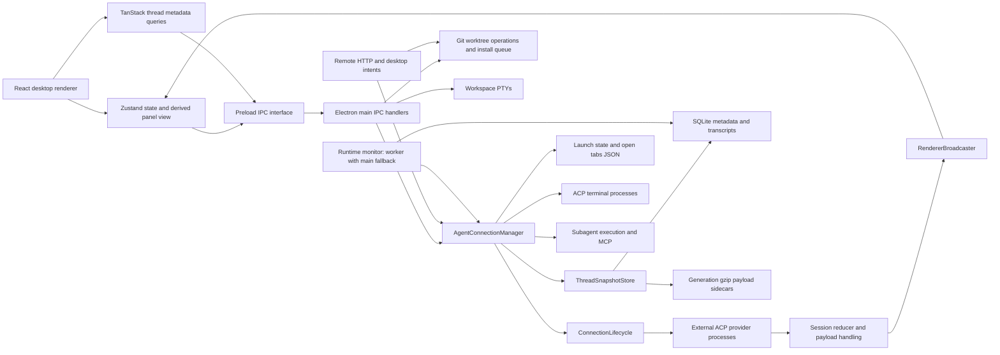

# Pipper architecture and performance investigation

Date: 15 October 2026. Source: working tree based on `490f89626a4c63b85a3723cf00be55288b74d192`, including the earlier resource fixes. This pass adds investigation tools and documentation; it does not refactor application behavior.

The [OpenCode follow-up](opencode/README.md) adds three completed independent explorations and new reproductions: incomplete subagent deadlines/cancellation, nested-slot scheduling stalls, app-wide snapshot fail-stop, queued snapshot retention, shared-database compaction waits, and ignored-event store notifications. It also corrects the original monitor-worker claim and reviews unsupported assertions from the subagents.

The strongest architectural problems are eager provider startup without idle ownership, a global activation queue that includes slow background preparation, synchronous Git and transcript work on Electron's main thread, whole-history storage operations for small changes, and caches bounded by item counts rather than bytes. These costs compound as users add providers, workspaces and history. They require changes to ownership and data flow, beyond the cache cleanup already implemented.

## Evidence and coverage

- [Measured workflow results](MEASUREMENTS.md) summarize three fresh Electron runs. [Raw traces](workflow-measurements.json) contain inclusive method spans, SQL/IO counts, process inventories and scenario timings.
- [Component measurements](component-measurements.json) exercise the actual snapshot store, streaming reducer, panel projection and renderer payload cache. The database queries use a **read-only** connection to the local installed application's database. Only aggregates/timings are exported, not transcript text.
- [Every-file index](FILE-MAP.md) and [machine-readable graph](module-map.json) list repository files and extract direct imports, IPC channels, IO operations and source hashes. The graph distinguishes type-only and dynamic imports. It is a syntactic graph, not proof that every reachable file executes on a thread operation.
- Manual tracing concentrated on the desktop startup, draft/thread creation, activation, streaming, restoration, tool expansion, worktree setup, connection lifetime, monitor, terminal and remote-task paths. The generated index covers the remaining UI, marketing, native/mobile, configuration, tests and assets. This is **not a claim that every file received line-by-line manual review or runtime profiling**. Native and marketing paths were not performance-profiled in this pass.

The Electron harness uses actual IPC, SQLite, Git repositories, ACP SDK transport and separate mock CLI processes. It builds a disposable copy of the current source, injects observation there, isolates user data/worktrees, and disables remote access and analytics. It never injects instrumentation into production source. Mock-provider latency is not Codex/Claude latency. Source wrappers add overhead; this is an architectural cost inventory, not a before/after speed claim. All three runs share the same machine; their min/max are descriptive, not production percentiles.

For reproducible streaming, the harness explicitly sets the existing visibility gate to visible for the two prompt scenarios. An earlier occluded run correctly suppressed deltas. The final harness asserts that all 82 active updates cross IPC and that a tool body survives persistence and restore. Request completion is not measured browser paint.

## Runtime architecture



There are two distinct kinds of terminal: workspace PTYs created in `main.ts`, and ACP terminal processes owned by `TerminalManager`. There are also two distinct caches: resident ACP sessions, and persisted display snapshots. A displayed snapshot does not establish that the agent has finished restoring its session. Conflating those states is a likely source of both incorrect optimizations and misleading timing reports.

### Ownership, readers, writers and transitions

| State                          | Trusted owner / writers                                                                             | Readers and transition risks                                                                                                                                                 |
| ------------------------------ | --------------------------------------------------------------------------------------------------- | ---------------------------------------------------------------------------------------------------------------------------------------------------------------------------- |
| Provider transport             | `connection-lifecycle.ts`: spawn, acquire, close, process/transport exit                            | Thread manager, catalog discovery, authentication and subagents share connections. Zero threads does not prove a connection is idle.                                         |
| Resident thread runtime        | `ThreadSessionRegistry`, mutated by manager activation, ACP events, prompt lifecycle and close      | Renderer snapshots, running-thread list, permission/terminal/MCP ownership. Thread ID and ACP session ID must stay bound across load/resume/new and exits.                   |
| Ordered transcript             | Main runtime is authoritative; renderer reduces active deltas and replaces from authoritative state | Snapshot replay has a separate accumulator. Optimistic user entries and late events must survive reconciliation without duplication or stale activation.                     |
| Thread metadata                | `threads.ts` / SQLite                                                                               | Thread list, tabs, remote interfaces and title updates. Renderer currently mirrors metadata in several caches.                                                               |
| Workspace/navigation selection | Main launch-state mutation queue and open-tabs operations                                           | Header, terminal cwd, worktree store, restart selection and remote activation. Concurrent writes must not lose fields.                                                       |
| Persisted display cache        | Snapshot generation write → rename → SQLite pointer update                                          | Restoration and selective body hydration. A reader may hold an old generation while another write replaces it. A budget is not permission to discard a live backing payload. |
| Hydrated tool bodies           | Main runtime live map; persisted sidecar; renderer `tool-payload-store.ts`                          | Diff/trace expansion and summaries. Ownership spans processes and caches; releasing only one map does not reclaim every copy.                                                |
| Workspace checkout             | Git's worktree registration plus validated filesystem paths                                         | Agent cwd, terminals, file tree, Git actions and remote isolated tasks. Cached identity must be revalidated before writes; generated files belong to the user/project.       |
| Monitoring                     | Main event accounting; intended worker with main fallback                                           | Monitor window and diagnostic tables. Diagnostics share the application's database and cannot be allowed to indefinitely amplify the workload.                               |

These invariants explain why simply removing queues, killing idle-looking processes or deleting worktrees would be incomplete architectural fixes.

## What a new thread touches

The normal draft send begins in `src/components/agent-panel.tsx` around line 1691. Its actual awaited sequence is:

1. Convert attachments, resolve draft project/workspace/provider/model and derive a title.
2. Call renderer `agent-store.createThread` → preload `agent:createThread` → `main.ts` handler → `AgentConnectionManager.createThread`.
3. Wait for the **global activation queue**, then enter `createThreadInternal`.
4. Read the project from SQLite; resolve/validate the cwd through worktree logic. A linked-worktree validation can execute Git and filesystem checks.
5. Acquire or switch the provider through `ConnectionLifecycle`. A cold provider resolves its executable/account configuration, spawns a CLI, creates an ACP stdio connection and waits for `initialize`. Cached providers reuse their process.
6. Build the session's MCP configuration and workspace guards; send ACP `session/new`; bind its session ID to the workspace.
7. Insert thread metadata, register its runtime, set active project/thread/provider context and touch last-used metadata.
8. Publish authoritative state **before** waiting for navigation persistence. This is an existing useful optimization.
9. Persist workspace selection and launch selection through separate mutations of the same JSON file. Apply an explicitly requested initial model before returning. Tab registration is a separate renderer reaction.
10. Renderer `createThread` calls `refresh`, fetching authoritative state again. The panel then awaits a project-thread-list reload and calls `selectThread` before sending the prompt. `GlobalTabBar` separately opens the tab when draft completion or the active snapshot changes.
11. `selectThread` has an existing same-thread fast path. It does **not necessarily perform a second ACP switch**. Whether that happens depends on whether the authoritative snapshot has already reached the store; it should not be counted as an unconditional extra switch.
12. `sendPrompt` appends an optimistic local user entry, then crosses IPC. The main manager prepares prompt blocks, obtains a ready runtime, queues per thread, sends `session/prompt`, consumes updates and settles the turn.

Important related modules are `projects.ts`, `threads.ts`, `db.ts`, `agent-instances.ts`, `agents/registry.ts`, `connection-lifecycle.ts`, `prompt-scheduler.ts`, `permission-coordinator.ts`, `workspace-guard.ts`, `subagents/*`, `renderer-broadcaster.ts`, `launch-state.ts`, `open-tabs.ts`, `thread-session-registry.ts`, `thread-snapshot-store.ts`, the shared ACP contracts, and the renderer reducer/projection modules. The file index supplies their direct dependencies and IO lines.

A thread creation and a workspace creation are separate operations. The ordinary thread path above does not inherently create a new checkout or install dependencies. Remote isolated tasks explicitly create a worktree first through `isolated-agent-task.ts`; the desktop's workspace-create IPC handler separately starts automatic dependency setup.

### Resident tab switch

`thread-actions.selectThread` → renderer switch queue → preload IPC → manager activation queue → SQLite thread/project lookup → cwd validation → resident runtime/provider selection → state broadcast → workspace/launch/tab persistence → tab-change notification → renderer metadata query refresh.

No new provider process or session replay is needed when the owning transport and session are resident. Nevertheless, the complete path still causes filesystem persistence and metadata follow-up work. Across ten measured IPC switches, the application made **40 launch-state writes**; the final result table reports the precise read counts for each run. Counts are scenario-wide and include concurrent renderer follow-up, not exclusively calls nested below the manager method. The manager itself schedules workspace selection, launch selection and switch-history mutations; the `GlobalTabBar` snapshot effect separately calls `tabs.open`, adding another queued mutation.

`switchThreadInternal` starts its diagnostic clock **after** the activation queue. The `main.ts` IPC wrapper also records a duration that includes the main queue. These are two different measurements; neither by itself includes time waiting in the renderer switch queue or proves a completed paint. Future traces must join them rather than treating them as interchangeable.

### Persisted thread restore

After the same lookup/cwd steps, `ThreadSnapshotStore.load` reads/parses a lean SQLite snapshot and publishes it before waiting for provider startup. Restoration then attempts supported ACP session load/resume/new behavior, routes replay into an offscreen accumulator, reconciles pending local entries and publishes authoritative state. It preserves special snapshot-only failure behavior and guards superseded activations.

This is already a sensible two-phase design. Its remaining weakness is that the supposedly fast display phase still synchronously reads and parses a whole transcript. The largest local row was **12,660,833 bytes despite only 214 entries**. Read-only SQL get took a median about 11.4 ms and JSON parsing about 6.8 ms separately, before trim, IPC cloning, projection or paint. An entry-count limit does not bound this cost.

### Streaming and tool expansion

ACP stdio notifications → O(1) reverse session lookup → main reducer → payload synchronization/accounting → active-delta broadcast or throttled background tool watermark → renderer reducer → compatibility panel projection → React subscriptions/virtualized conversation.

Existing optimizations worth preserving: background text deltas are not sent to the renderer; hidden windows coalesce high-volume deltas and catch up with state; live prompt chunks do not trigger a full state snapshot per chunk; changed tool records can be sent as deltas; replay uses an in-place reducer; settled projected messages keep referential identity; expensive diff extraction is deferred to settled turns/explicit views; conversation DOM is virtualized.

Expanding a persisted tool calls `getToolCalls(threadId, ids)`. The sidecar reader creates a gunzip stream and parses JSON lines until it finds every requested ID. It is selective in what it **returns**, but finding a late ID still scans preceding records. The earlier request-scoped hydration fix saves retained main-process RAM while exposing this repeated-read tradeoff.

## Architectural decisions ranked by impact

### 1. Provider availability/catalog lookup starts long-lived execution resources

**Confirmed behavior; high priority for multi-agent RAM.** `getModelCatalogs` acquires every selected provider and enabled selected-driver instance. Providers that advertise models only in a session get a temporary `session/new`/close probe. The connection cache keeps those processes after the temporary session closes. Repeated discovery can repeat temporary session work because those session-only catalogs are not persisted in the main manager's result cache. The renderer's persisted model catalog does not prevent this main-process warming operation.

In the measured scenario, closing all runtimes left three provider processes. Catalog discovery for eight selected agents added six more, leaving nine connections including the deliberately slow ninth provider, with **zero resident sessions**. No process-per-thread design is involved: the good existing decision is one cached process per provider instance, multiplexing its sessions. The problem is creation/lifetime policy.

**Recommended interface:** separate cached catalog lookup from explicit refresh, and make connection acquisition return an owned lease. Track uses by sessions, prompts, catalog probes, auth flows and subagent execution. Refresh only the selected provider when needed, deduplicate concurrent refreshes, cache results/errors with bounded freshness, and release idle providers after a grace period. Keep a deliberate warm-provider policy where low switch latency is worth the RAM.

**Verification:** selected-but-unused providers do not spawn on a cached lookup; simultaneous requests spawn once; a refresh lease prevents idle disposal; active/background prompts, authentication and subagents survive the timeout; process count falls after the last lease/grace interval. Measure real provider process-tree memory before setting a target. Mock process RSS is not a production saving estimate.

### 2. All thread preparation shares the UI activation queue

**Reproduced latency coupling; high priority.** Create, switch, close and delete share `enqueueThreadActivation`. Background creation joins this queue despite not needing to become the active UI thread. Cold initialization and session requests can therefore delay a resident tab switch in another thread/provider.

The harness injected a **400 ms initialize delay** into one local provider. A resident switch requested 20 ms later waited approximately 0.42 seconds. The exact final measurements are linked above. This is a controlled proof of blocking, not a claim that production providers initialize in 400 ms. Real defaults allow much longer ACP phases, including up to 120 seconds for npx initialization.

**Recommended interface:** prepare a per-thread runtime independently from committing active UI selection. Keep per-thread mutation exclusion, per-provider spawn deduplication and a short ordered activation commit. Use activation generations to reject stale commits and release preparation resources on cancellation/failure. Background create should not acquire the UI activation lock. Closing a busy thread should settle its own prompts without waiting for an unrelated provider handshake.

**Verification:** the controlled-delay test must show a resident switch completing while preparation is still blocked; latest selection wins across rapid A→B→A clicks; a late old initialization cannot overwrite current context; cwd, MCP, permission and terminal bindings remain scoped to the correct session. Removing the global queue without these checks would introduce correctness regressions.

### 3. Blocking Git operations run on Electron's main thread

**Confirmed synchronous execution; local latency measured.** `worktree-manager.ts` uses `execFileSync` for Git. Workspace creation includes several probes, base resolution, checkout creation and post-create listing. The small local fixture takes roughly 150 ms end to end; its precise final range is in the table. There is no dependency install or network in that fixture.

The base-selection path can synchronously `fetch origin` with a **60,000 ms timeout**. An optional setup script also uses synchronous shell execution without a timeout in that helper. Those are code-path limits/risks, not reproduced 60-second stalls. A blocked main loop also delays IPC, stream handling and monitor reporting; moving only the package installer to a queue does not address this Git work.

**Recommended interface:** an asynchronous repository-operation module with a queue per repository, cancellation/timeouts and structured results. Keep a valid cached base for immediate use according to explicit freshness rules; refresh remote refs outside interaction-critical work. Preserve path containment, per-repository Git ordering, rollback and dirty-worktree semantics. File mention fallback traversal should use the same asynchronous filesystem seam rather than synchronous recursion in an async handler.

**Verification:** a delayed fake Git child does not block a main-process heartbeat or streaming in another project; two conflicting mutations of the same repository remain ordered; different repositories can progress concurrently; cancellation/rollback do not delete another operation's worktree. Test a slow remote separately from a large local checkout.

### 4. Snapshot storage is whole-history oriented

**Measured amplification; high priority for long histories and frequent turns.** One gzip generation contains all tool bodies. A selective late-body request scans from the beginning. Each generation rewrite merges prior bodies, recompresses the whole file and updates a whole lean transcript row. The asynchronous streams and periodic yields help responsiveness, but they do not eliminate bytes read/written or JSON serialization on main.

With 128 high-entropy 32 KiB bodies (4 MiB total), sixteen separate late-ID reads took about 0.23 seconds; one batched read took about 15 ms. Appending a 16,413-byte record rewrote a roughly 3.2 MB compressed generation in about 69 ms: around **194× compressed output bytes per changed JSON byte**. Compression, high-entropy input and machine state matter; this ratio is not a universal production figure.

**Recommended progression:** first coalesce concurrent hydration requests per thread/generation. Then store bodies by `(thread, generation/tool ID)` in indexed records or immutable chunks with an index, so an expansion is proportional to the requested body. Use transactionally maintained metadata and bounded chunk sizes; benchmark per-record compression against the current ratio. Keep lean transcript indexing/pagination separate from large bodies. Consider a storage worker where serialization/parse and database waits dominate.

**Verification:** old/new stores return byte-equivalent bodies and preserve live-update precedence; concurrent readers survive a new generation; crash between data write and pointer commit keeps the last valid generation; schema upgrades can fall back safely; append writes scale with changed data, and random access does not scan unrelated bodies. Stream-based storage is not itself the problem; the unit of storage is.

### 5. The previous budget fix added a synchronous whole-table cost

**Newly measured cost introduced in the earlier pass.** Including transcript bytes fixed incorrect disk-budget accounting. Its current `enforceLimit` query computes `length(CAST(slice_json AS BLOB))` for every snapshot after writes. On the local database's 84 rows / 49,674,737 transcript bytes, it took about **17.5 ms synchronously**. The metadata-only comparison still took about 7.4 ms in that schema, so dropping the expression alone is neither a complete performance fix nor correct accounting.

**Recommended change:** store transcript-byte and aggregate storage-byte metadata when writing the generation, update it in the same transaction and maintain LRU/budget accounting without reading transcript contents. A narrow metadata table/index can avoid pulling large row bodies. Backfill once outside the UI path and verify exact UTF-8 bytes. Retain pinned-reader/live-runtime semantics and document that the current 512 MiB limit is a soft display-cache budget, not total database or disk capacity.

**Verification:** stored byte metadata matches serialized UTF-8 values, including Unicode; large historical rows do not increase a new small write's accounting time; crash/retry and eviction preserve totals. This should be an early follow-up because it corrects the performance tradeoff of a fix already made.

### 6. Count limits and cleanup events substitute for byte ownership

**Confirmed mechanisms, with separate measurements.** Main transcripts cap entries/tools, but individual entries and `rawInput` can be arbitrarily large. `toLeanToolCall` deliberately retains `rawInput`: a 1 MiB input serialized to **1,048,656 bytes**, while a 1 MiB output reduced to a 352-byte lean record. Snapshot tables, active IPC snapshots and renderer memory can therefore contain large bodies even when the type is called lean.

The renderer payload cache has no byte/LRU limit. It discards removed tool IDs and forgets a thread on `thread-closed`, but switching among still-open threads does not release the hydrated bodies. The production module retained about **11.9 MiB of heap** after 24 × 512 KiB test bodies, until explicit cleanup. The diff store caps 100 retained threads, not bytes of old/new file content. Resident runtime caches also need a policy beyond per-session entry counts.

**Recommended interface:** one resource-budget policy expressed by byte ownership, with separate limits for live working data, display history, hydrated bodies, diffs and disk. Treat expandable persisted bodies as evictable; pin currently displayed data and in-flight updates. Keep the main/renderer distinction: GC or cleanup in one process does not reclaim another process's cache. Put large tool inputs behind the same payload interface only after tracing consumers that need arguments for summaries and diffs.

**Verification:** many open threads cannot exceed the hydrated-body budget; expand→evict→expand preserves complete data; active edits/diffs still work after eviction; one huge entry does not evade limits; memory returns after thread close and idle eviction. Validate heap retention after GC separately from OS RSS.

### 7. Navigation state has one file but many operations and renderer mirrors

**Measured redundant IO; modest isolated latency, significant repeated work.** The shared launch-state mutation queue correctly prevents lost updates. However, workspace selection, launch selection, tab activation and switch history are separate read-modify-writes. `Promise.all` on two callers does not parallelize them because both join that same mutation queue. `writeOpenTabsState` reads again after its caller already read the state.

The renderer also keeps thread metadata in the open-tabs query, project-thread queries and Zustand thread state. A tab event updates query data and then invalidates/refetches it; fetching tabs requires a second IPC to fetch thread rows. Title changes patch multiple caches. Thread creation emits state and then renderer `refresh` fetches it again.

**Recommended interface:** a navigation module exposing one atomic `activateThread` transaction that returns the committed selection/tabs and a revision. Persist with an atomic file replacement or a SQLite transaction; keep a memory mirror whose durability/error behavior is explicit. Coalesce identical updates. A single canonical renderer metadata cache should consume committed metadata deltas; project lists can retain query pagination rather than a second independent thread owner.

**Verification:** concurrent open/switch/workspace changes never lose fields, failed persistence reports the actual committed state, restart recovers a complete file, stale revisions cannot overwrite current selection, and one resident switch performs one durable navigation update. Reduce the repeated IO while retaining serialization's correctness benefit.

### 8. Renderer derivation and broad subscriptions scale with history

**Measured CPU scaling; not evidence of a frame-rate failure by itself.** Live updates copy the entry array tail and count tool keys. The compatibility projection still scans/assembles arrays for chat, synthetic tool results, message-entry references and streaming selection. Existing WeakMap/prefix caches preserve settled objects, but do not make the surrounding iteration constant time. `AgentPanel` subscribes to the whole agent store; its React Compiler opt-out is explicit and must be respected when changing its virtualizer integration.

The controlled 1,000-chunk measurements are in `MEASUREMENTS.md`. A large history materially increases projection work, while the reducer alone is much cheaper in this fixture. These totals exclude React layout/paint and do not establish a production bottleneck at normal token rates. Prioritize confirmed blocking storage/process costs first unless a representative visible trace points here.

**Recommended change:** keep an incremental active-tail projection, cache synthetic tool results by tool-map revision, narrow UI subscriptions and coalesce adjacent text chunks at a bounded interval. Flush immediately for permission/tool/stop/selection events and before visibility catch-up. Avoid redundant full-state fetches when the authoritative event already provides the required state.

**Verification:** final state and interleaved order match the unbatched reducer; message IDs, optimistic echo deduplication and streamed tool transitions remain correct; permissions are never delayed behind text batching; measure event-to-paint and React commits with representative long histories before claiming an FPS win.

### 9. Dependency materialization and worktree lifetime have no unified storage policy

**Confirmed disk multiplier; customer exhaustion not reproduced.** Git worktrees already share the repository's object database. Each checkout still materializes tracked files and can acquire its own dependency/build outputs. The prior local inventory found 13 worktrees; this checkout alone had approximately 1.09 GB of dependency file bytes across 110,224 files. Most other local worktrees were small. Allocated blocks can overcount APFS shared extents, so these are not exact unique physical savings.

The earlier install queue and opt-out improve concurrency/control, but automatic installation still defaults to enabled. They do not deduplicate dependencies, remove existing outputs or provide lifecycle accounting. Remote isolated tasks call worktree creation through a different entry point from the desktop setup wrapper. That should be an explicit setup policy, not accidental divergence.

**Recommended interface:** a workspace lifecycle module that owns create/prepare/status/archive operations, records storage by category, and gives the caller an explicit source-only versus prepared policy. Detect and use the project's existing package manager/store behavior; do not assume pnpm or Bun eliminates all per-worktree data. Add a reviewable cleanup flow for known generated outputs, age/last use and worktree status. Preserve untracked user files, active sessions, running processes and custom setup outputs unless explicitly selected.

**Verification:** create 1/4/8/16 real workspaces from representative projects, perform builds and compare logical bytes, allocated blocks and package-manager store growth. Check archive/reopen behavior, dirty worktrees and native modules. A shared writable `node_modules` symlink is not a safe general solution across branches/install scripts/platform-specific dependencies.

### 10. Diagnostics and terminal continuity have recurring resource costs

**Source-confirmed; total cost needs a dedicated workload.** Monitoring is enabled by default and samples at 1 Hz. On macOS it invokes up to two `ps` processes per sampled non-main PID per tick, then merges samples/rings. This scales with provider/window/PTY count. That subprocess count is derived from source, not measured syscall tracing. The source intends worker sampling/recording, but the built-app verification found `new Worker(new URL("./worker.ts", import.meta.url))` resolving to a missing build artifact. Worker startup failed and sampling continued through the main-process fallback. The earlier version of this report incorrectly described worker isolation as established. Incident/connection/navigation records also use synchronous main-process database calls, and diagnostics share `omni.sqlite`. Building live-monitor snapshots also happens before the receiver decides whether a monitor window exists.

[Built-app evidence](opencode/monitor-worker-verification.json) records the missing worker file, worker failure callbacks and continuing samples. Reproduce with `node scripts/verify-built-monitor-worker.mjs` after building. This proves fallback behavior in the current local build, not a measured CPU penalty or verification of a distributed installer. The worker failure counter receives both error and nonzero-exit callbacks; its value is not a count of distinct worker processes.

The earlier audit found around 159 MiB of freeze-incident table pages. The visibility fix prevents a reproduced class of hidden timer/RAF reports; it does not prove every historical incident was false or automatically remove historical data. The new workflow runs include monitoring on/off variants, but three small runs cannot establish its CPU/RAM penalty.

Workspace terminal sessions intentionally remain mounted and their PTYs continue across workspace switches. Histories are bounded per session; total emulator/PTY/session count is not governed by a global byte policy. ACP terminals have a separate default 1 MiB output budget and explicit session release. Preserving live shells is useful, but many visited workspaces can create another retention axis beyond agent count.

**Recommended change:** emit the monitor worker as an explicit build entry and verify the resolved packaged artifact, expose worker-versus-fallback mode in health, and test failure policy. Then separate cheap always-on counters from detailed tracing, sample detailed process/thread state adaptively, batch process collection, and bound incident bytes/age. Consider a separate diagnostics database to isolate retention and write contention. For workspace terminals, separate PTY lifetime from emulator view lifetime and test a bounded attach/detach/replay model before changing it. Never infer that a hidden shell is safe to kill.

**Verification:** fixed 0/8/16/32-provider and terminal workloads with monitor closed/open/recording; measure total process CPU, main-loop delay, worker queue, database growth and memory. For terminal view detachment, test interactive alternate-screen apps, control sequences, resize, cwd and lossless reconnection, not merely plain text output.

## Startup and file-level coupling

The import graph has 130 local runtime modules reachable statically from `src/main.tsx`, versus 138 including dynamic edges; `electron/main.ts` reaches 82 statically. These counts include entry modules and exclude third-party package internals. They describe coupling, not milliseconds or retained heap.

`App.tsx` declares the terminal view lazy, but `advanced-shell.tsx` imports it statically and is itself imported by `App`. That defeats isolation of that module on the common desktop entry. There are already useful lazy seams for diffs and other views. Verify emitted chunks and startup milestones before deciding what to defer; do not move critical state initialization behind a lazy view merely to lower the count. The existing `bench:fixture`, `bench:thread`, `bench:open` and `bench:query` commands reference an absent `benchmarks/` directory in this checkout, so they cannot serve as reproducible regression gates as checked out.

Marketing/server routes, mobile/Swift/Expo clients, native intents and the sleepless helper have separate entry points. They do not all run on a desktop thread creation. Remote HTTP and OS-intent entry points eventually join the same manager and workspace operations; improving that seam benefits those callers, whereas desktop-only UI work does not.

## Recommended implementation sequence

1. **Make measurements cover the complete interaction.** Keep the new controlled benchmarks. Add a correlation ID through renderer queue → IPC → activation queue → display-ready → agent-ready → durable → first visible paint. Keep phase clocks separate, and avoid recording prompt contents. These are intended measurements, not claims already provided by this report.
2. **Correct expensive budget accounting and batch hydration.** These are localized, measured storage costs with clear integrity tests, including a cost introduced by the earlier fix.
3. **Split catalog reads from startup and introduce connection leases.** This addresses the direct multiplier in multi-provider RAM. Establish idle ownership before adding disposal.
4. **Move Git work to asynchronous per-repository execution and separate preparation from activation.** Keep selection and repository ordering explicit. Measure a blocked provider and a blocked Git child while switching a resident thread.
5. **Consolidate navigation persistence and renderer metadata.** Reduce repeated writes/fetches using one revisioned committed result, with crash/restart tests.
6. **Add byte budgets and indexed body/transcript storage.** Track live/persisted/renderer ownership, migrate safely, and use long-history mixed-size workloads.
7. **Optimize renderer, diagnostics and terminals against representative traces.** The source identifies scaling risks; instrument them before changing continuity or update cadence.

The manager is large, but splitting it into many pass-through classes would not establish a performance benefit. Prefer deep modules at the actual seams: provider ownership, runtime preparation/activation, navigation commit, repository execution and indexed transcript/body storage. Each should hide ordering, failure, lifetime and performance rules from callers, and be verified through the same interface desktop and remote callers use.

## Reproduce and interpret the measurements

```sh
node scripts/analyze-architecture.mjs
node scripts/benchmark-architecture.mjs --runs 3
PIPPER_ARCHITECTURE_BENCH=1 \
PIPPER_ARCHITECTURE_REPORT="$PWD/docs/architecture/component-measurements.json" \
PIPPER_ARCHITECTURE_DATABASE="/absolute/path/to/omni.sqlite" \
bun run test electron/architecture-costs.bench.test.ts --maxWorkers=1 --execArgv=--expose-gc
node scripts/summarize-architecture.mjs
```

The database argument is optional: without it, only the local database-query scenarios are omitted and the omission is recorded. Electron execution requires a desktop-capable environment and local process/loopback access. The workflow harness deletes only its own temporary source/fixture directories when it exits. It does not create worktrees in a user's project.

Raw spans are inclusive: a method includes children and async waits, and overlapping spans cannot be summed into a critical path. Scenario-wide IO totals can include background preloads and renderer reactions that occur during that stage. `snapshot-settle` deliberately waits 2.3 seconds for the app's 2-second debounce; it is not 2.3 seconds of storage work. `startupToFixtureMs` includes a fixed 1.2-second settling wait and is not an app-open benchmark. Process-tree RSS counts shared pages repeatedly and is not unique physical memory. The report makes no Windows, real-provider, customer-repository, whole-app speedup or peak-memory claim.

Validation of this pass is recorded in [VALIDATION.md](VALIDATION.md). Earlier resource fixes and their independent before/after evidence remain in [the resource report](../performance/README.md).
